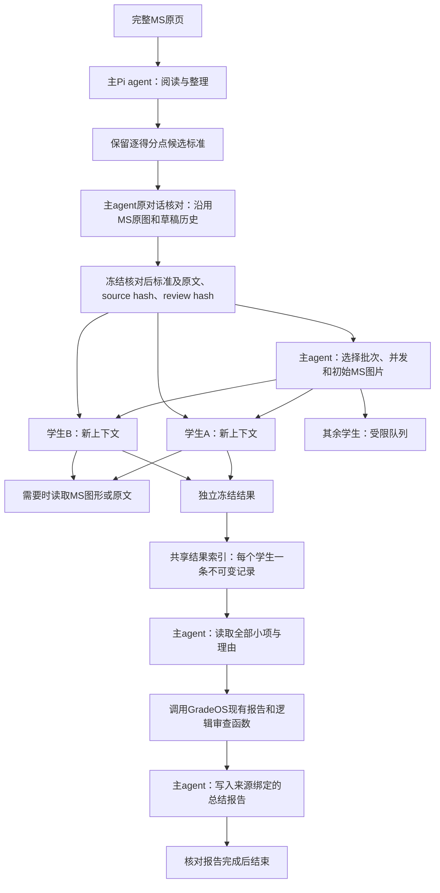

> 独立仓库说明：安装见 [README](README.md)，当前依赖边界见 [架构](docs/ARCHITECTURE.md)。下方保留原型工作流与历史实验；GradeOS 报告函数现已在本仓库内执行。

# Pi 批改实验

固定 MS 工作流先准备评分实施文档，老师确认后，由脚本按答卷派发 Luna。
以下当前入口和历史模型编排流程分开说明。

## 当前选用：Luna 单次批改、脚本批注

`npm run grade:cohort -- ...` 默认使用 Luna、中等思考档、严格评分点键、短普通满分理由、
页外行列标尺及同次返回位置。macOS 的本地 Vision 提供可错的文字候选和行位置；
原图和确认后的评分标准仍是依据。每份答卷一次请求，批注绘制与汇总不再调用模型。

确认后的评分实施正文和冻结标准原样送入；整份答卷全部附图。
已验证标准只补充全局规则、图像依赖及有疑点的 MS 原页，可用 `--all-ms-images` 附上全部 MS。
例外给分交老师审阅；没有自动重试、独立判分复核或第二次定位调用。
这些约束解决执行和成本问题，不能保证 Luna 的手写符号识读正确，结果仍需全卷审阅。

```sh
npm run grade:cohort -- --manifest /absolute/path/cohort.json --output /absolute/path/preflight \
  --rubric /absolute/path/reviewed/rubric.json --approved-guide /absolute/path/marking-guide.json
```

默认只生成计划；实际调用另加 `--execute` 及凭据、预算参数。此预设启用 macOS 本地 OCR；
其他平台请直接调用 `run-cohort.mjs` 并省略 `--local-ocr`，不能把该配置称为同一对照实测。
2026-11-16 的同输入、无缓存读取对照：无批注 $0.019116175，含标尺/位置提示/坐标输出
$0.020289050，增量 $0.001172875（6.14%）。这是冻结 MS 与确认 MD 之后的单份重放，
不包含前期 MS 生成费用；一轮样本不能证明平均成本或稳定性。两臂评分均仍有原稿误读。

## 同一批改子agent自查（Sol调度、Luna执行）

`npm run grade:cohort:self-review -- ...` 使用6.1 Sol处理共享MS、并行派发与汇总，
每个Luna子agent在自己的同一会话里完成“初批 → 自查 → 局部修正 → 最终保存”。
此入口是本轮多轮agent方案，不启用`--scripted`。

第一次通过完整校验的提交只保存`grading-primary.json`和`submission-primary.json`。
必须再经过一次模型响应，子agent才能提交`submit_self_review`：列出全部已核查小项，
只输出修改的小项和其中真正改变的评分点，未改点从初稿原样沿用；换评分路线时才提供该路线完整点集。
无修改时传空数组。原有合并和评分校验继续生效；
最后写入`grading.json`，个人报告和主agent汇总都使用这一最终版本。
自查失败时保留初稿，整份任务显示未完成，不把初稿当作最终成绩。

自查保留原MS、图片和历史前缀，仍可针对具体问题查原图。同一会话有机会读取缓存，
但API请求仍包含原图，缓存命中与实际费用必须按回执统计，不声称零图片输入。
主agent不再逐生复核；自查包含在每个学生的并行任务内，也不另开复核agent。
`student_self_review`单独记录耗时和费用。模型自查可能延续第一次误读，不能称为独立复核。

自查改变作答证据或引用页码时，`evidence_revisions`只为这些点补充原图页码、页内位置、
实际可见内容和修改依据；旧、新观察由宿主从初稿和修正稿自动保留。已有图片足够时无需
重复查图，是否调用原页工具仍由子agent决定。仅改变评分解释时保持原识读，并给出明确短理由；
未修改的普通满分点继续简写。宿主检查引用页是否实际送达、是否属于该点及修改覆盖，
不把“填写了来源”当作笔迹内容正确的证明，也不把自行算出的答案替换为学生原文。

```sh
npm run grade:cohort:self-review -- --manifest /absolute/path/cohort.json \
  --rubric /absolute/path/rubric.json --output /absolute/path/new-output
```

默认只生成计划；付费执行仍需`--execute`、有效凭据文件与预算。

## 历史模型编排流程

下文描述直接调用 `run-cohort.mjs` 且不加 `--scripted` 的旧流程、独立模型报告及历史实验，
不代表当前 `grade:cohort` 的默认执行链。



共享标准保留通用说明、逐小项的奖分类型/分值/条件、依赖、替代方法、互斥路线、f.t.、
相关题目和源页，以及无法可靠文本表达的视觉要求。它在任何学生任务开始前冻结。
子agent只可提出复核，不能修改标准；当前入口不自动修订标准或重新批改已尝试学生。

## 模型工具

| 使用者 | 工具 | 责任 |
|---|---|---|
| 主 | `read_ms_pages` | 仅编译阶段阅读完整MS，含通用说明与续页；冻结后禁止全卷读取入口 |
| 主 | `inspect_ms` | 冻结后为具体疑问读取最多4个相关题项、4页源图，校验题项/关联题/通用规则的页码归属 |
| 主 | `write_rubric_items` | 每次最多4小项增量写入草稿；后续续页可修订，冻结后禁止修改 |
| 主 | `prepare_ms_review` | 保存候选标准检查点，保留当前对话的原图和草稿；下一轮开始自查 |
| 主 | `submit_ms_review` | 沿用同一对话核对全部MS原页，逐项确认后冻结；仅按源文修正，保留候选与差异 |
| 主 | `grade_students` | 动态选择学生ID、并发和初始MS页；每学生建立全新Pi Agent |
| 主 | `finish_cohort` | 全部学生终态后结束，保留失败/取消 |
| 主 | `read_cohort_results` | 所有学生终态后，每批最多读取10份完整小项得分、理由和页码引用 |
| 主 | `read_point_evidence` | 在读完对应小项后，按需读取最多4条学生/小项的完整逐点证据与源规则 |
| 主 | `save_report_notes` | 完整证据交付并收到下一轮模型响应后，保存带引用的分析笔记，压缩已处理批次及点/图视图 |
| 主 | `analyze_cohort` | 调用GradeOS原有学生摘要、班级统计和全局逻辑审查；不改分 |
| 主 | `submit_cohort_report` | 全部记录读完且分析完成后，写入主agent报告和来源hash |
| 子 | `read_student_pages` | 仅读取自身答卷 |
| 子 | `read_ms_pages` | 按需回看同一MS原页 |
| 子 | `report_ms_issue` | v3读取相关原图后登记规则冲突；v4改为最终提交内联`source_issues`，均绑定小项/得分点，不能改共享标准 |
| 子 | `submit_grading` | 每小项选一条评分路线，逐点提交依据；校验合法分值、依赖、求和及复核状态 |

主agent决定初始图像包。子agent仍可因图形、版面、公式歧义或规则不明请求原图。
若共享标准把某项标为必须看图，宿主会验证相应MS页确实交付后才允许提交。
并非只有“画图题”可能需要图片；表格、空间关系和难以可靠转写的记号也可能需要。

## 宿主边界

- 30个学生对应30个独立逻辑任务，默认不设置宿主并发上限；实际批次和并发由主agent选择。只有显式 `--concurrency` 才限制。
- 主工具按顺序执行并等待每批孩子收尾。当前 `StudentRegistry` 不独立承担跨批次全局限流，
  不应直接改成并行父工具而保留其他实现不变。
- 所有主/子请求共享一个原子准入预算、聚合请求上限和15分钟deadline；每个lane单独绑定回执。
  请求上限默认120，可用 `--max-requests` 配置。30名学生至少需要30次评分和30次反馈调用，另有主调用，
  因此真正运行30人时必须预先设定足够的总请求额度与费用预算，不能沿用单学生测试限额。
- 取消传播到所有运行中的agent，停止新调度；失败与未知费用保留，失败不变成学生零分。
- 调度工具先返回每个孩子的状态、总分、复核状态、结果路径和费用摘要。所有孩子结束后，
  主agent必须通过结果读取工具查看每一份完整小项得分、理由和引用；不接收学生图片或整份评分对话。
- MS冻结后，主请求用成功发布回合及导航目录替换之前的草稿对话；复用入口直接接收导航目录，学生仍接收全部评分规则。主agent按具体疑问查源；同一未记录笔记的视图最多4张源图。完整原始对话仍落盘，孩子按需取图不受影响。
- 复用减少的是图片及重复解析；每个子agent仍接收共享标准文本，其token和潜在缓存费用仍须计入。

## 输入和运行

一个cohort输入引用已准备的图像目录。每个目录的manifest只需包含将使用的role。

```json
{
  "scheme_input": "/absolute/path/prepared-ms",
  "students": [
    {"id": "001", "input": "/absolute/path/prepared-student-001"},
    {"id": "002", "input": "/absolute/path/prepared-student-002"}
  ]
}
```

```sh
python3 prepare.py --scheme /absolute/path/ms.pdf --output /absolute/path/prepared-ms
python3 prepare.py --student /absolute/path/answer-001.pdf --output /absolute/path/prepared-student-001
node src/run-cohort.mjs --manifest /absolute/path/cohort.json --output /absolute/path/preflight
node src/run-cohort.mjs --manifest /absolute/path/cohort.json --output /absolute/path/run-1 \
  --env /absolute/path/ignored-openrouter.env --cap 1 --concurrency 4 --execute
```

凭据也可只通过进程环境提供。每次运行使用新目录；生成总计划、冻结rubric、主/子对话及请求回执、
每学生grading与summary、全批次summary。官方参考分仅交给事后的 `evaluate.py`。
默认入口每批次重新整理一次MS；下述复用模式可跳过该阶段。

可分别指定主 agent 和执行 agent 的模型，例如 `--model openai/gpt-6.1-sol --worker-model openai/gpt-6-luna`。
主模型负责 MS 整理、原对话核对、调度和汇总；执行模型负责学生批改、需要时的例外核查和个人反馈。
省略 `--worker-model` 时沿用 `--model`，保持原有单模型运行方式。两类模型共用批次预算、请求上限和截止时间，
按各自价格预留，并保存每次请求的配置模型、实际模型、provider 和实际费用；不会因任务失败自动换模型。

完整答卷首轮随请求交付的协议，直接检查已附图片即可满足原有页覆盖条件，不要求再调用读图工具。
MS 编制按当前请求的输出 token 额度规划完整小项批次，不再固定每次最多四项。
`write_rubric_items` 使用短字段名传输，宿主无损恢复原完整结构；评分条件、来源原文、页码、分值、依赖、路线与不确定性仍须显式提交。
当原文已表达完整给分条件时，`condition:null` 明确引用同点 `source`，宿主逐字恢复完整字段；需要解释、方法或限定时仍须另写完整条件。缺字段不推断默认值。题概述不重复所有评分点，局部疑点只保留在该题；全局或无法定位的疑点仍保留全局备注。核对继续使用主 agent 原会话。
`read_student_pages`仍返回原始未裁白页，但须提供具体视觉疑问，避免为了页覆盖重复扫描整卷。
`correct_grading`统一处理被拒草稿：提交当前 hash 和完整的修改/缺失小题，其他题保持原样；顶层元数据用 null 保留或数组明确替换。未通过完整覆盖、证据、分值和复核校验前不保存最终结果。缺题优先报出，避免先补理由再发现缺题。
修正请求尽量只包含受影响及相关小题、完整评分条件与必要原图；无法安全定位或有交互指令时保留全上下文。`reopen_grading`仅用于确需恢复原始完整上下文的重新提交。没有添加第二套修复状态机。
局部疑点仍要求对应题复核及详细理由；全局备注仍要求明确 review_notes，并保留整份结果的待复核状态，但不单凭全局备注强制无关满分点重复解释。
个人反馈的必填选择按各评分点状态收窄schema动作组合，复用已有验证规则；没有新增报告复核agent或付费阶段。

初次批改和局部修正共用同一条视觉证据提示：先忠实读取学生笔迹，不能按MS补全缺失数字、符号或步骤。
当给分取决于尚未辨清的笔迹时，只回看相关原页；仍无法判断则保留 `null` 与复核，不能把“不清楚”当作“没有写”。
这是模型行为提示，不是关键词拦截器，也不强制清晰页面重复查图；工具不可用时同样保留不确定性。
2026-11-16的固定MS对照仅各跑一份，仍发现模型补全不存在的作答证据，不能把该提示视为识别正确性的保证。

`evidence-v4`的首交schema绑定当前MS的全部小项数和ID，要求一次提交完整账本，避免把局部修正工具当作分批提交入口。
修正仍可只替换受影响的小项；如果草稿缺题，下一次补交须一次补齐。已定位修正只带相关及关联小项的完整条件、证据和必要原页。
没有可信页码归属时保留完整上下文，不为减少图片猜测题页；原图工具始终可按需使用。
来源绑定汇总为每份已读取记录提供`evidence_ref_prefix`，模型直接拼接原样item_id，错误或跨学生引用仍拒绝。
经济报告模式的调度和汇总输出上限均为4096 token。预算复用已有供应商回执来计量完全相同的输入前缀，
追加内容仍保守估算，输入按适用的普通/缓存写入较高价格预留，不假定缓存折扣；回执不完整或输入变化仍回退保守估算。

也可显式复用先前冻结的标准：

```sh
node src/run-cohort.mjs --manifest /absolute/path/cohort-30.json --output /absolute/path/replay-1 \
  --rubric /absolute/path/prior-run/rubric.json --cap 5 --concurrency 4 --max-requests 128 --execute
```

`--rubric`要求同目录的`.sha256`文件，并校验文件内容、rubric内容hash和当前MS源绑定。
复用模式的主agent只负责调度，没有`prepare_ms_review`、`submit_ms_review`和草稿编辑工具；它收到完整冻结文字与必读图页清单。
每个任务仍独立阅读自身答卷并可补取MS原图；学生协议由版本和显式参数决定。本轮MS整理调用和新增费用为零；
历史整理成本只能在报表中明确摊入，不能再次算作供应商新增扣费。更完整的标准库与权限管理仍属后续产品接入。

## 费用与验收

费用拆为：一次MS整理 + 主agent在原对话中的MS核对 + 主agent调度 + 各学生批改（含按需MS图）+ 各生学习反馈 + 主agent汇总报告。
单学生场景新增整理步骤可能更贵。多学生可以摊薄整理成本，但不能把一名学生结果乘30后称作30人实测。
代码中的费用上限是保守准入估算，不是供应商账单硬封顶。

## 保留逐点依据的学生协议

v2 标准默认使用 `--student-protocol evidence-v3`。宿主在首个学生请求中按物理页序交付完整答卷，
消除模型逐批请求下一组答卷的往返；仍可用 `read_student_pages` 重看，或用 `read_ms_pages` 补取原始 MS。
首轮请求包含全部页面只证明图像已交付，不证明模型正确识别每页。大型答卷仍受原有输入准入限制，
当前没有自动分片后备策略。显式 `--student-protocol legacy` 可重现旧的按需读答卷路径；v1 标准默认使用旧路径。

模型交付每小项的路线与复核状态，以及每个得分点的八格记录：

```
[point_id, score_or_null, observed_evidence, student_pages, relation, error_origin, rule_ref, reason]
```

实际观察、分数和理由均由模型提供并原样保存；宿主从冻结标准补齐固定题号、满分与源页，再计算小项合计。
原始紧凑提交保存为 `submission.json`，展开的逐点账本保存为 `grading.json`；两者均绑定 hash。
`met` 表示源条件（含明确允许的部分分档）满足，`unmet` 为已知不满足且零分，`uncertain` 保留 null 与复核。
正分若依赖例外，须用 `exception`，区分继承错误与当前新错误，并引用通用规则 `G1…` 或本点原文 `P`。
当前/混合错误的例外正分必须标为待复核。普通合法部分分无需伪造例外；前点失分不会自动让所有后点失分。

这只是使矛盾和规则依据可审计：宿主检查格式、引用存在、分值、依赖和复核状态，**不判断公式等价或例外实际适用性**。
已有规则被误用、错误被模型标为无误，仍可能通过结构校验。学生 Markdown 保留每点原文、观察、判断和关系，
并附引用的通用规则；复核标志不能当作正确评分证明。

运行回执另记录 HTTP 响应头、首个流事件、首个输出增量和首个可见推理增量时间。
这些均以宿主观察为准；从请求准入到首输出包含本地准备、网络、供应商排队和处理，不能直接解释为纯读图耗时。
旧回执没有首 token 时间，不能对旧请求事后精确拆分预填充、排队与生成。

当前新编译标准为 v2：每个得分点保留原文、源页、奖分类型、合法分值、条件和无条件前置点。
一小项可声明多条互斥完整评分路线；每条路线的点分值独立等于该小项满分，不能把替代路线相加。
学生只选择一条支持其答案的路线并交齐该路线所有点。宿主检查覆盖、合法分值、无条件依赖及求和；
不会判断数学等价或从模型理由中推断该给多少分。含糊的规则应保留不确定性并要求原图/复核。

MS核对由主agent在整理时的同一段对话中完成，不启动另一个核对agent。`prepare_ms_review`只返回候选hash和题项目录，
原图、最新草稿和工具前缀继续保留；下一轮主agent检查原文、提交逐项核对和必要修正，完成后才压缩为导航上下文。
这给供应商前缀缓存保留命中机会，是否命中以实际用量回执为准。核对阶段不读取学生、历史成绩或事后参考标签。
核对结果可以保留标准、按原文修正或标记待复核；它是主agent自查，不代表独立核验或人工正确性认证。候选 `rubric-draft.json`、
核对 `ms-review/review.json` 和最终 `rubric.json` 各自落盘并以hash互相绑定。新版v2复用必须带核对记录；
旧v1仍可显式复用以读取历史实验，但不因此获得新版核对资格。

原图疑义记录在学生结果的 `source_issues`；主agent读结果时可见。阻碍给分的疑义保留null和复核，
其他疑义保留暂定分和复核。共享标准在本批不变，不按学生结果自动改写或重跑。后续修订必须新版本、
明确列出受影响题项与结果；当前实验不自动发布成绩。

## 主报告上下文与按需查图

主agent冻结后的常规入口不再暴露全卷 `read_ms_pages`；`inspect_ms` 必须给出具体疑问、题项和源页。
题项自身、关联题及通用规则允许交叉查询，陌生题号或无关页拒绝。图像读取仍验证原文件hash。
导航目录只用于调度和选图；它没有替代学生收到的完整标准，也没有删掉原有逐点评分账本。

`read_cohort_results` 每次最多10人，交付所有小项分数、理由、引用、源文问题和反馈复核建议。
读取下一批前，必须先用 `save_report_notes` 保存当前批次的简洁观察和证据引用。只有工具返回真正进入
下一次模型上下文、并收到模型响应，才允许保存笔记或完成报告；同一工具批次的“读取→立即保存”会拒绝。
最后一批可保留完整内容直接完成报告，不强制增加一次笔记调用。

压缩后的批次保留每个人、每一小项的原分数/满分/null/复核状态，以及review_notes、source_issues、
反馈复核索引、失败状态和原始文件路径/hash。模型笔记不能修改这些字段。完整理由与逐点依据仍在不可变文件、
原始transcript和工具读取入口中；点/图视图也可在记录笔记后清理，再按需恢复。同一分析的重复交付在确认消费后
去重，完整GradeOS分析文件仍保留。笔记保存为 `report-notes-N.json`，报告绑定笔记及实际读取的源视图。

未checkpoint的文本视图上限为150,000 UTF-8字节，源图最多4页；内容过大时要求先保存笔记或缩小读取批次，
不静默截断。这个上限**不是完整上下文保证**：全部历史、笔记、工具参数仍由最终请求的原有272,000保守输入准入
检查兜底。批次大小只影响报告读取，不限制学生批改并发。

可以不发模型请求，执行真实Pi循环、实际GradeOS分析及OpenRouter序列化来验证30人容量：

```sh
node src/check-report-capacity.mjs --source /absolute/path/completed-cohort --output /absolute/path/capacity-new
```

脚本在最终payload回调无条件阻止HTTP，覆盖普通10人批次、点/图检查、5人压力批次、未知分、失败记录、
不合法同批checkpoint及报告收尾。它保存每个请求的体量和完整工具历史，校验所有原账本不变。这不是30人
付费批改、模型总结质量、并发吞吐或真实账单测试；费用必须另按真实单生回执和明确假设估算。

离线测试包含实际Pi父子调用、源图不随父上下文继承、需要图时补取、冻结集合与源引用约束、
30任务并发/失败隔离/唯一性、全局预算与取消。真实质量需要单独完整M2评估和标准原页审查。

## 首轮真实结果与后续修正

2026-11-14的首轮主+单学生实验完整提交77/100，31/34小项一致、绝对误差3，仍为M2回归失败。
共11次模型响应、182.393秒，供应商费用$0.2146369：MS整理$0.06680325、协调$0.00777185、学生$0.1400618。
主仅给孩子MS页8、12、17，孩子后来补页7，最终只使用4个不同MS页；没有继承父对话。

本轮没有省钱。学生内部三次提交校验失败：缺页7时错误提示过于笼统，孩子重复读取了已有3页；
之后又因缺全局MS复核说明被拒。四次提交尝试总分均77；最后一次冻结，没有依据参考分选择候选。
首个提交失败之后的5次调用花费$0.05907715，全部计入结果。

随后将必需MS页清单和复核要求直接交给父/子，报错指出具体缺页/规则；这是结构交付信息修正，
不修改评分规则或分数。最终代码通过15项JS与3项Python检查。修正后未再次进行付费试跑，
不将可能减少的调用数当作已实现节省，也不把单学生结果外推为30人实测。


## 子agent写入后由主agent报告

`submit_grading`先冻结每个学生自己的`grading.json`，再以该学生身份写入`results/<id>.json`收据。
收据只引用原始文件及其hash，不复制一份可以独立改分的账本。30个写者互不覆盖；全体终态后封存
`results/index.json`。主agent必须读完全部记录的小项得分、理由、疑义和个人反馈摘要、调用分析、提交报告，才允许`finish_cohort`。完整逐点账本保存在学生文件中，经`read_point_evidence`按需读取；不默认把全部学生所有点重复塞进主上下文。
失败任务保留状态和原因，没有数字结果，不作为零分进入统计。

直接复用本仓库的`_build_student_summary`、`_build_class_report`和`build_global_logic_review_audit`，
通过本地Python适配器调用，不重写其公式、不启动GradeOS批改管线、不访问生产数据库。
报告函数已提取到本仓库 `analytics.py`，仅依赖 Python 标准库。报告附函数源文件hash，另将重复性统计标为harness补充。

新版保存逐点判断及模型记录的证据；旧版只有小项得分与理由。两者都不伪造官方内部M/A标签、知识图谱标签、JEV分类或校准Risk。GradeOS适配器仍运行项级统计；逐点约束由harness核验，未接入GradeOS完整逐点证据审计。
GradeOS旧报告的knowledge_points字段在此只能解释为小项得分代理，内部A–E分档不是官方考试等级。
同答卷重复实验的及格率、离群值与薄弱项都要按模拟范围解释。

对已经完成的批次，可单独补跑主agent报告阶段：

```sh
node src/run-report.mjs --source /absolute/path/completed-cohort --output /absolute/path/report-preflight
node src/run-report.mjs --source /absolute/path/completed-cohort --output /absolute/path/report-run \
  --cap 1 --execute
```

这会核验和导入历史子agent已写入的成绩、建立共享索引，再运行新的Pi主报告会话；不会重新批改学生。
`report.json`保存模型总结，`gradeos-analysis.json`保存实际GradeOS分析，`REPORT.zh-CN.md`组合确定性数字、
主agent解释、来源与覆盖限制。官方参考不进入报告agent；需要时保留为单独的事后评测附件。

只更新 Markdown 排版时，无需再次调用模型：

```sh
node src/render-report.mjs --report-dir /absolute/path/report-run
```

离线渲染器校验冻结报告、分析和共享索引，然后原位更新 `REPORT.zh-CN.md`，保留所有 JSON 与费用回执。
报告提供总分分布、波动小项、可点击的复核证据、费用拆分、完整小项明细和分析边界。
若目录已有 `cost-accounting.json`，渲染时一并保留失败尝试费用；可选 `report-presentation.json`
仅提供标题、署名、费用说明和附件链接，不参与评分或模型上下文。

## 学生个人总结与逐题反馈

新批次在每名学生的原始分数冻结后，运行独立 Pi 反馈会话，输出
`feedback-<id>/feedback.json`、`REPORT.zh-CN.md` 和单独的费用回执。
其内容包括一段整体评价、带小项引用的优势、可检验的练习计划，以及每小项的评分依据、
判分说明、改进建议与教师复核提示。报告保留原始理由和物理页码供核查。

反馈只读取该生冻结结果和共享 MS，不重看图片、不读取官方标签或其他学生结果，也没有改分工具。
不能从小项总分反推内部 M/A 点分配。无法支持的细节必须注明，原有待复核状态和空分不能被清除。
主 Agent 读取共享结果时也会收到该生反馈摘要与复核提示；这些文字不是独立评分意见或新图像证据。

`student_feedback` 独立计入阶段费用；学生 `elapsed_seconds` 包含评分和反馈阶段，
`grading_elapsed_seconds` 与 `feedback_elapsed_seconds` 分别记录两段耗时。
反馈失败不会抹去已完成的评分，批次会保留 `feedback_complete=false` 并标为未全部完成。
新批次默认总预算为 $2、最多 120 个请求；已有显式 `--cap` 仍然优先，反馈也占用同一个总预算。

对已完成的批次补齐个人反馈：

```sh
node src/run-student-feedback.mjs --source /absolute/path/completed-cohort \
  --output /absolute/path/student-feedback-preflight --cap 2 --concurrency 4
node src/run-student-feedback.mjs --source /absolute/path/completed-cohort \
  --output /absolute/path/student-feedback-run --cap 2 --concurrency 4 --execute
```

默认仅校验输入并生成运行计划。执行时沿用原批次模型，默认不设人为并发上限，保留所有失败和费用；
不将反馈补充当作重新批改或准确率提升。原始评分文件、MS、旧报告及其校验值保持不变。

## 主上下文修复后的单次复测

2026-11-15 的 `m2-report-context-1` 复用原核对MS，只改变主agent上下文与报告工具，学生/反馈提示与
首个学生请求（除隔离namespace）和 `m2-point-evidence-1` 相同。完整流程119.425秒、10请求、$0.13855675；
基线118.740秒、7请求、$0.21416080。实付降低35.3%，耗时没有下降。主调度/汇总合计从$0.08074730降至
$0.02443720，主agent所有请求均0张MS图；学生主动补看2页MS，批改任务50.364→57.248秒。

本次首次评分和反馈命中共享提示缓存；将这两次cacheRead按cacheWrite补差后，全流程价格情景为$0.16591555，
不能把全部实付差额归因于代码。真实输出77/100，31/34小项一致：12(c)末点在查源后按跟随规则给1并标复核，
整项由上次1变2，仍与官方不一致。全部100点原始字段和宿主结果一致，主笔记保留5(c)、12(c)复核标志。
这是源文解释差异，主压缩没有改分；本次严格结论仍为M2回归失败。

以本次结果构造的30人离线序列化容量检查覆盖普通/按需取证/压力路径，保守输入峰值分别162,676、199,546、
210,277，低于272,000门槛；49项JS和5项Python检查通过。容量测试没有付费模型调用，也不证明模型能正确
总结30人或批改稳定。没有因评分不匹配再次运行M2。

## 例外给分范围核查

`evidence-v3` 区分前问继承错误和当前小题新错误；同一小题的上一行不能自动当成“前一小题”。
每个拟议正分例外必须说明所有影响该点的错误及源许可。局部f.t.允许跟随，但不能推定其范围无限，
也不能额外发明“所有M都得分才能给A”的依赖；确实未明的范围保留null与源疑义。

初稿冻结为`student-<id>/grading-primary.json`。`exception-review.mjs`只抽取正分exception，
每批最多4个点交给独立Pi agent，提供相关小项及原始MS、答卷页；不携带官方标签或其他学生记录。
核查必须逐个绑定错误来源页、原引用规则和短引文，明确全部错误是否被许可、当前操作是否有效。
模型判定confirmed保留、rejected归零、unresolved保留null；宿主仅验证来源/覆盖与计算总和。
引用有效并不机械证明语义正确，仍需语义probe和人工评测。核查失败时保留初稿但不发布为完成结果。
费用独立记录为`exception_review`，与最初MS核对`ms_verification`分开。

2026-11-15单次`m2-exception-review-1`复用原MS：12(c)由2恢复1，5(c)末f.t.点由1改为待定。
官方小项一致32/34（上次31/34），剩余5(c)待定、10(c)(i)1对官方2；已确定75个分值、1个点评分未知，
不产生确定总分。本次primary没有正分exception，独立核查未触发，不能声称实卷验证了该核查的图像能力。
全流程135.916秒、13请求、$0.17345495；主批改64.965秒/$0.10474485，个人反馈40.452秒/$0.04147550。
上次119.425秒/$0.13855675；本次多一轮源疑义上报和主报告按需查源。首次批改/反馈无cacheRead，
上次冷开局重计$0.16591555后与本次相差约4.5%；不将缓存差异全部归因于修复。

56项JS、5项Python检查通过。主批改中性probe11/11；核查首版probe因页码/引用绑定未完成，
6次调用$0.04069060全部保留。明确通用来源契约后同一中性fixture9/9、3请求、无工具错误；
没有按M2标签重跑。全部开发probe共$0.08060010，和M2运行账单分列。

## 精简反馈与汇总模式

`run-cohort.mjs --economy-reporting`使用`compact-v2`个人反馈，并将实际GradeOS统计附在第一次
`read_cohort_results`返回中。所有学生仍先写入结果；主Agent必须在后续模型响应中消费结果和统计，
才可提交报告。`submit_cohort_report`成功持久化后自动完成cohort；若cohort落盘失败，状态不记完成。
原有按需读点/查图、分批checkpoint和完整原始文件均保留。

精简反馈只生成总结、优势、优先练习、每项短评与建议。输入保留一次整项条件、选中路线、全部点条件、
原文、证据、理由、例外权限和源疑义；不重复发送整份MS、拼接的item reason以及固定元数据。
宿主从冻结文件渲染100点评分依据，模型没有改分接口。默认详细模式仍可用于比较。

单独重写已有成绩的反馈：

```sh
node src/run-student-feedback.mjs --source /absolute/completed-cohort \
  --output /absolute/new-feedback --mode compact-v2 --isolate-student-cache --cap .12 --execute
```

2026-11-15 `m2-economy-1`单次冻结MS复测：全流程135.916→99.737秒，13→7请求，
$0.17345495→$0.12713580。全部34项/100点分值与基线一致；首学生实际wire仅隔离namespace不同。
首次学生cacheRead为11,918，上次0；冷开局重计为$0.14143740，仍下降18.5%。
主批改64.965→66.703秒，没有提速；个人报告40.452→19.675秒，主汇总8→2请求。
同一冻结grade的最终反馈控制19.144秒/$0.02092925，首次cacheRead0，34项/100点完整。
两次反馈控制共$0.04066725均保留；第一版源条件遗漏经只读审查发现并修复后才运行M2。

62项JS、5项Python检查通过。30人普通/查图/压力场景的实际Pi序列化峰值173,551/210,442/217,664，
均低于272,000；仅离线容量验证，不是30人真实并发测试。判分规则、图片、模型、推理和独立例外核查未变。

## 主批改紧凑协议与纯白边缘裁剪

显式指定`--student-protocol evidence-v4`启用六格协议，v3仍保留作对照。每点必须提交：

```
[point_id, score_or_null, observed_evidence, student_pages, state, reason]
```

`state`明确编码relation/error_origin/rule_ref：`m`、`u:N`、`q:N`或`x:N:R`，宿主可逆展开为v3八字段。
全部点，包括零分和null，仍逐点提交证据、页码及理由。不得从省略字段或顺序推断分数/身份。
源疑义放在最终提交的`source_issues`中，和成绩一起校验后才落盘；不再额外调用登记工具。
v4分别跟踪工具返回图片和成功模型输入确认图片，同批读图并立即提交不能绕过来源交付门禁。

可再加`--trim-white-margins`：使用本地Python去除答卷图像外侧完全纯白的空边，不缩放、不去噪、
不删页，保留每个非白RGB像素；空白与非RGB页保留完整。补白恢复原图解码像素并逐字节验证，
另校验写盘文件、来源hash和页序。裁剪改变画布及实际视觉输入，不宣称模型视觉表示不变。
MS图保持原样，`read_student_pages`始终可取完整未裁原页。只在v4允许此选项，默认仍用原图。

```sh
node src/run-cohort.mjs --manifest /absolute/cohort.json --output /absolute/new-run \
  --rubric /absolute/frozen/rubric.json --student-protocol evidence-v4 \
  --trim-white-margins --economy-reporting --isolate-student-cache \
  --env /absolute/ignored-openrouter.env --cap .8 --max-requests 20 --execute
```

2026-11-15单次`m2-primary-economy-1`复用原MS：主批改66.703→61.187秒，3→2请求；
全流程99.737→95.786秒（本次含0.936秒图片准备，模型/工具运行94.850秒）。全部34项/100点分值、
null和review状态不变；12(c)=1，5(c)末点待定，官方项分一致仍32/34。文字依据会重新生成，
5(c)待定点错误来源current→unknown，5点页引用收窄；不将分值相同说成依据逐字相同。

28页裁图均可补白恢复原像素，实际请求图片hash逐页匹配；像素面积减少20.3%，首输入总token
58,044→49,538。最终提交却51.330→51.960秒、输出4,119→4,250 token；精简状态字段没有明显
降低逐点生成量，证据/理由增长抵消了格式节省。此次提速主要是少一次源疑义上报往返。

实付$0.12713580→$0.12207900，其中约91%的账面节省来自主调度首次缓存差异。
把每lane首次cacheRead改按cacheWrite计、保留本轮后续缓存，价格情景$0.14143740→$0.12668580，
降10.4%，不是另一次冷运行。冷开局批改+个人反馈30人外推$3.809055→$3.3639225，
不含班级主调度/汇总、历史MS整理/核对或可能触发的例外核查，也不证明30人并发耗时。

66项JS、8项Python检查通过；11个非M2中性模型案例通过。仅一次M2，无分数导向重试，
开发probe$0.00925925单列；本轮M2+probe合计$0.13133825，全部费用回执齐全。

## 逐点评据共享协议

`--student-protocol evidence-v5`沿用v4图像、源疑义和评分规则，只将模型提交改为小项内证据表与显式引用：

```text
e: [[evidence_id, literal_observation, student_pages], ...]
p: [[point_id, score_or_null, evidence_ids, state, reason], ...]
```

同一段真实观察仅写一次；每点评分、状态、引用数组和独立理由仍必填，零分与null不能省略。
引用只能解析本小项的bank ID，不允许跨小项偷用ID。合法前题依赖可以在当前表内明确记录前题来源、
真实观察及页码；出现相同观察不意味着两个点必须同分。缺失、重复、空引用、未知页和未使用证据拒绝。
原始`submission.json`保留五格点记录，`grading.json`展开完整逐点文本与页码并集，并保留
`evidence_bank`及`evidence_refs`。多段观察在反馈输入和Markdown中逐段标明其原页，不只显示页码并集。
v4仍可显式运行作为对照，v5不是默认替代。`--trim-white-margins`对两者均可用，原图读取保持可用。

本协议的中性检查包含三种等价表达、同一证据支持不同奖分、错误方法/答案、其他文类、未知字符，
以及“前页错误输入、后页正确操作”的合法跟随给分。结构压缩并不保证减少总token；短证据可能因ID开销变大。

2026-11-15单次`m2-shared-evidence-1`对比`m2-primary-economy-1`：34项、100点分值、关系、错误来源、
规则引用及review状态一致；5(c)末点仍null，12(c)=1，固定官方参考一致32/34，严格M2回归仍fail。
输入28张裁图实际payload指纹与v4相同，补看MS原页6/19，原图读取与交付门禁保留。

这次**没有达到降本提速目标**：主批改61.187→76.931秒，全流程含图片准备95.786→113.225秒，
实付$0.12207900→$0.13381270。两轮首次缓存相同；冷写入价格情景$0.12668580→$0.13841950。
最终输出4,250→5,727 token，首输出后45.207→62.976秒，主请求仍2次、全程6次。
本次81条证据、112次引用；同一候选账本从v4格式14,082字节压为v5的13,323字节，净省759字节。
但候选观察与理由比上次更长，整体JSON仍从10,243增至13,323字节；字节节省不能冒充实际token节省。
反馈完整展开后冷写入10,595→13,462 token，费用$0.02147175→$0.02558550。

71项JS检查、20个中性模型案例（28点）通过；只运行一次M2，无按分数重试、无工具错误或未知费用。
probe费用$0.01707550单列，本轮M2+probe总计$0.15088820。v5保留实验开关，当前证据不支持替换v4。

## 普通满分点的简短理由

使用`--student-protocol evidence-v4 --reason-style brief-full-credit`回到六格直接逐点证据，
不使用v5证据引用表。仅普通满分点可以在reason字段显式写`=`，声明“Full criterion met.”；
宿主只展开这个固定句子，保留`reason_encoding`和原始提交，不推断或修改任何分数。

简写要求state=m、分数等于源点满分、item review=false，且没有该项源疑义、源uncertainty或全局
未解决说明。部分分、零分、null、例外/跟随给分以及争议项必须写具体理由；满分点若需要额外解释，
也可以继续写完整理由。所有点始终保留原观察、页码、评分条件、路线与状态；原图按需读取和输入
交付门禁不变。Markdown注明固定句子来自模型显式声明，不伪称宿主独立复核。

默认reason-style仍为detailed，旧v4与v5实验均可复现。此模式没有为M2题号或目标分数建立分支。

2026-11-15单次`m2-brief-reasons-1`未通过判分/复核语义保持验收：5(c)/a由null→0，item review
由true→false，整卷变为75。99/100点分与33/34小项保持原值；12(c)=1，固定官方项分33/34，
严格M2回归仍fail。新增匹配不能当作更准确：该点原始模型理由没有处理local f.t.范围，且未请求MS原图。
0分在原始submission中就存在，该点没有用`=`，primary=final，宿主没有通过简写展开改分。

75处普通满分声明展开为固定句、25点保留文字理由；100点证据、页码与理由逐项还原检查通过。
但“已声明无争议”的结构门禁不能识别模型漏报的疑义；因此5(c)中原需详细说明的m1也被列为普通满分。
76项JS与20个中性模型案例/28点通过，不抵消本次真实语义路径变化。

全流程含图片准备95.786→87.312秒，主批改61.187→54.340秒；实付$0.12207900→$0.11765555，
首次冷写入情景$0.12668580→$0.12226235。两轮首次缓存相同，差额不是首次缓存优惠。
主要少了一次MS读取往返（2→1主批改请求）；最终提交输出反而4,250→4,332 token，首输出后
45.207→46.264秒，没有测得逐点生成提速。不得将少做源文核查视为保持判分的压缩收益。

本次M2与probe分别$0.11765555、$0.01562675，合计$0.13328230；所有回执齐全，无追加重跑。
候选保持实验开关，当前不建议替换原v4详细理由路径。未更改原账本或按参考分强制修正5(c)。

## 并发与不同答卷的成本估算

`run-cohort.mjs` 和 `run-student-feedback.mjs` 默认不设置固定并发上限，运行计划中的
`host_concurrency_limit` / `concurrency` 为 `null`。主 Agent 仍可动态选择批次和并发数；
反馈补跑默认允许该批所有任务同时执行。只有显式传入 `--concurrency N` 时才设置上限，
不再拒绝大于 4 的值。总费用、请求次数与截止时间约束继续独立生效；不承诺供应商没有容量限制。

同卷重复测试不适合直接代表不同答卷的输入费用。`run-cohort.mjs --isolate-student-cache`
在学生批改和个人反馈请求的第一个 user 内容前加入一次运行内固定的非语义 namespace，
放在共享 system/MS 前缀之后、学生内容之前。不同学生的 namespace 不同，同一学生同一阶段的
后续请求保持一致。它不修改答卷、MS、评分规则或官方标签；实际隔离效果仍须核对 provider 回执，
不能把所有 cache-read 都当作跨学生缓存，同一学生的会话内复用也可能合理命中。

单份复测应单列：实际支付、批改、个人反馈、主 Agent 协调与汇总、MS 一次性历史费用。
估算不同的 30 份答卷时，将学生阶段费用乘以 30，单独估算主报告开销；另外给出按普通输入价
或冷写入价重计 cache-read 的敏感性情景。情景值不是实际账单，单份运行也不证明 30 并发的耗时。

## 非满分点的源规则核对与独立复核

`--student-protocol evidence-v4 --reason-style brief-full-credit --source-permission-review`
保留普通满分点的显式简写，新增两层可审计检查。此开关仍为可选，不改旧实验的默认路径。

主批改须对每个低于源点满分或null的点提交source_assessments，并通过
`inspect_scoring_sources`读取点/小项/关联小项和全部通用规则对应的原MS页。返回图片逐页去重，
只有实际进入前一模型输入才算交付。空白、普通0分和模型自称无例外均不免检。完整解释只写入
已有point reason；source_assessments只记录结论和规则引用。P绑定完整源条件，G编号绑定一般规则。
明确point_ids的阻塞性source issue要求对应每点null，不能用同题其他点的null掩盖已确定的0分。

随后宿主从不可变primary账本枚举全部非满分/null及正分例外点，交给独立fresh agent。
主模型自评resolved不能移除目标。独立agent收到完整相关P/G规则、原始MS页和相关答卷页，
可按需读取答卷剩余页，仍需prior-input交付；逐点明确确认、恢复源支持的给分或保留待定。
宿主验证target全覆盖、primary/packet/source绑定、引文、页码、允许分值及完整ledger，
再应用其显式决定，不根据官方目标修分。复核失败保留primary并阻止final发布；原始输出和改分始终留档。

费用中的`student_grading`仅初判，`source_permission_review`为独立核对；单生summary总批改费为两者之和。
个人反馈和主Agent汇总另列。所有lane第一次缓存命中需单独核查；source-review lane同样有隔离namespace。

该机制的确定性保证是覆盖、来源交付与记录完整性，不保证模型的源解释必然正确；独立模型复核也不等于教师确认。
全部非满分点都查图和独立复核会增加成本，必须以实测结果评价，不能称为已经降本。

2026-11-15单次`m2-source-permissions-1`：86项JS、中性真实模型30案例/38点评分通过。
主批改实际查12页MS，23个最终非满分点源检查；独立复核覆盖23点加2个正分例外，共25点。
5(c)末A点由上一轮0变为1，保留review；12(c)末M初判1，独立改为null。最终总分null，
已确定点和76不能当最终总分。固定官方一致31/34；严格M2回归fail，98/100点分值保持。

相比短理由上一轮，全流程含准备87.312→154.613秒，实付$0.11765555→$0.26122080；
首请求冷写归一$0.12226235→$0.26122080。主批改54.340→68.563秒、4332→5105输出token；
独立复核另41.780秒、3223输出token、$0.09551425。全流程输出6645→11540 token，5→8请求。
主报告因source hash mismatch被门禁拒绝一次，约9.186秒修正请求计入上述成本；无学生重跑。

新增M2+开发probe费$0.32601575。仅批改/复核/个人反馈估30份$7.210683（$0.2403561/人），
不含共享MS历史成本和30人主汇总，也不是并发实测。本候选封住漏查入口，但判分保持和成本目标未达；
仍为可选验证方案，不替换默认。两份Markdown添加事后人工核定说明，原始JSON及分值未改。
# Main-agent review before reports

The normal `evidence-v4` cohort path now keeps each worker result as
`grading-primary.json` and returns `awaiting_review`. The existing main agent
receives all point decisions alongside the full frozen source conditions,
including ordinary full-credit points; worker review flags do not select its scope.
It can inspect original answer pages and the existing scoped MS source tool.
This replaces the separate exception-only worker review on this path.

The main agent submits checked item IDs and complete changed items only. Changed
items require their original answer pages to have reached a subsequent main-agent
response. Existing point validation, short full-credit reasons, source uncertainty
and unknown scores remain intact. Review patches are immutable and preserve the
primary; only after complete coverage does the host save `grading.json`, run
personal feedback once and publish the final shared result. Reports therefore
consume the reviewed grade hash. The `main_grading_review` phase bills the same
main model separately; it is not a new model session.

Review packets use the existing bounded report context. Successful review commits
checkpoint consumed views; `save_report_notes` can release intermediate source
images, with `student_ids=[]`. A subsequent student replaces the full previous
ledger with immutable references and review notes. This is coverage of all textual
point evidence, not a claim that every answer page was visually rechecked or that
every score is correct. Scripted execution and the explicit source-permission
experiment retain their own execution paths.

Same-student self-review binds its immutable primary inside the owning session;
`submit_self_review` no longer asks the model to copy a submission hash. Audit
artifacts still retain both the draft and final hashes. Each changed observation
needs original-page grounds; one point may cite multiple distinct pages, while
duplicate point/page entries, missing grounds and undelivered pages remain invalid.

Context admission preserves the conversation, images and encrypted reasoning on
the wire. For an unchanged provider-confirmed prefix, an exactly matched encrypted
response uses that response's measured output-token count plus all other appended
bytes/images as the bound. Unknown or altered blobs keep the full byte estimate;
cache discounts are never assumed for admission. This changes budgeting, not the
model's visible evidence, scoring rules or short-reason policy.

