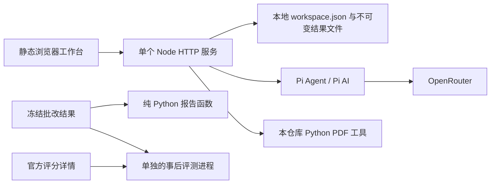

# 独立运行边界

GradeOS Pi 从 GradeOS 的 `experiments/pi-grading` 当前工作树提取，作为后续产品替代的起点。

## 当前调用链

| 链路 | 原依赖 | 独立后 | 保留的契约 |
| --- | --- | --- | --- |
| PDF 导入、裁切和批注导出 | `GradeOS/backend/.venv` | 本仓库 `.venv`；可显式配置 Python | 原页像素、页面坐标、文件哈希、失败可见 |
| 班级报告 | `review_utils` 导入整个后端服务图 | `scripts/python/analytics.py` 中原函数的确定快照 | 原统计公式、不可用分数排除、无成绩写入 |
| 批改工作台 | 原型目录中的 Node 服务 | 独立 Node 服务和静态模块 | 原 Pi 类、工具、人工确认、取消和恢复 |
| 测试资料 | Skill 目录和历史 artifact 目录 | `evals/fixtures` 下自行安装的本地材料 | 原 PDF 字节和 SHA-256；官方标签仅事后使用 |

Node 使用 Pi、KaTeX 和本地请求计数器 js-tiktoken。Python 使用 Pillow、NumPy、pypdf 和 ReportLab，PDF 渲染使用 Poppler。macOS 可用 Vision 识别文字行，其他平台可选本机 Tesseract。依赖版本记录在锁文件中。
无需 Next.js、FastAPI、LangGraph、PostgreSQL、Redis 或 Docker，也不读取旧仓库的环境变量文件。

`scripts/python/analytics.py` 保留原函数体，去掉 facade 全局重绑定和后端导入链。
[analytics.json](provenance/analytics.json) 记录原文件、函数位置和哈希；中性样本对比覆盖
缺失成绩、部分未知、分档、低分项与离群提示。这里的知识点字段仍只是题项得分代理。
`gradeos.*` 方法名作为既有报告格式中的标识保留，实际执行的函数已经在本仓库内。

## 数据与权限

`WorkspaceStore` 是本地工作台状态的唯一写入者，通过临时文件加原子重命名持久化。
冻结批改结果和教师修订分别保留；复核不覆盖原判分。模型请求仍保留预算、取消、
使用量和失败状态。官方标签既不作为工具提供，也不由运行时扫描加载。

当前服务只监听 `127.0.0.1`，保留 Host、Origin 和工作台写入令牌校验。
工作台可与独立云端服务配对。教师预览所选学生及评分点后发布，学生账号、班级权限与在线成绩版本归接收端管理。参见[成绩发布协议](CLOUD-PUBLISH.md)。

## 后续替代路径

1. **当前基线**：独立安装、工作台、导入、批改契约、复核、PDF 导出和测试资产。
2. **质量基线**：按同一配置记录真实 M2 批改，比较全部官方题项；化学及新的独立标签
   分开报告。未知分数和模型失败保持可见。离线测试不能代替此阶段。
3. **教师日常使用**：补齐必要的作业、班级、结果导入导出；由实际消费者决定接口，
   不预先复制旧系统所有模块。
4. **生产边界**：若需要多人联网，再加入身份、学校隔离、备份、持久任务与审计。
   从旧系统迁移记录必须保留原结果、教师修订和来源关系，并验证数量与内容一致性。
5. **切换**：先验证完整教师和学生流程，再分批切换；保留可回退的数据与服务。

本次建立替代基础，不迁移生产用户、成绩或基础设施。
