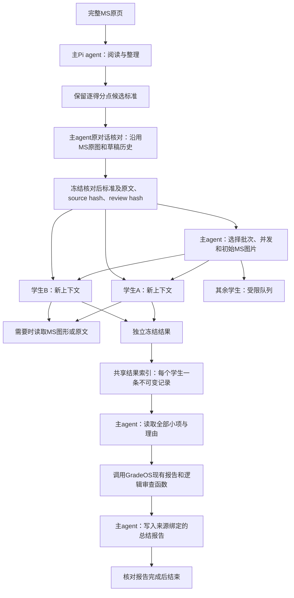

> 独立仓库说明：安装见 [README](../README.md)，当前依赖边界见 [架构](ARCHITECTURE.md)。下方保留原型工作流与历史实验；GradeOS 报告函数现已在本仓库内执行。

# Pi 批改实验

固定 MS 工作流先准备评分实施文档，老师确认后，由脚本按答卷派发 Luna。
以下当前入口和历史模型编排流程分开说明。

## 当前选用：Luna 单次批改、脚本批注

`npm run grade:cohort -- ...` 默认使用 Luna、中等思考档、严格评分点键、短普通满分理由、
页外行列标尺及同次返回位置。macOS 的本地 Vision 提供可错的文字候选和行位置；
原图和确认后的评分标准仍是依据。每份答卷一次请求，批注绘制与汇总不再调用模型。

确认后的评分实施正文和冻结标准原样送入；整份答卷全部附图。
已验证标准只补充全局规则、图像依赖及有疑点的 MS 原页，可用 `--all-ms-images` 附上全部 MS。
例外给分交老师审阅；没有自动重试、独立判分复核或第二次定位调用。
这些约束解决执行和成本问题，不能保证 Luna 的手写符号识读正确，结果仍需全卷审阅。

```sh
npm run grade:cohort -- --manifest /absolute/path/cohort.json --output /absolute/path/preflight \
  --rubric /absolute/path/reviewed/rubric.json --approved-guide /absolute/path/marking-guide.json
```

默认只生成计划；实际调用另加 `--execute` 及凭据、预算参数。此预设启用 macOS 本地 OCR；
其他平台请直接调用 `run-cohort.mjs` 并省略 `--local-ocr`，不能把该配置称为同一对照实测。
2026-11-16 的同输入、无缓存读取对照：无批注 $0.019116175，含标尺/位置提示/坐标输出
$0.020289050，增量 $0.001172875（6.14%）。这是冻结 MS 与确认 MD 之后的单份重放，
不包含前期 MS 生成费用；一轮样本不能证明平均成本或稳定性。两臂评分均仍有原稿误读。

## 同一批改子agent自查（Sol调度、Luna执行）

`npm run grade:cohort:self-review -- ...` 使用6.1 Sol处理共享MS、并行派发与汇总，
每个Luna子agent在自己的同一会话里完成“初批 → 自查 → 局部修正 → 最终保存”。
此入口是本轮多轮agent方案，不启用`--scripted`。

第一次通过完整校验的提交只保存`grading-primary.json`和`submission-primary.json`。
必须再经过一次模型响应，子agent才能提交`submit_self_review`：列出全部已核查小项，
只输出修改的小项和其中真正改变的评分点，未改点从初稿原样沿用；换评分路线时才提供该路线完整点集。
无修改时传空数组。原有合并和评分校验继续生效；
最后写入`grading.json`，个人报告和主agent汇总都使用这一最终版本。
自查失败时保留初稿，整份任务显示未完成，不把初稿当作最终成绩。

自查保留原MS、图片和历史前缀，仍可针对具体问题查原图。同一会话有机会读取缓存，
但API请求仍包含原图，缓存命中与实际费用必须按回执统计，不声称零图片输入。
主agent不再逐生复核；自查包含在每个学生的并行任务内，也不另开复核agent。
`student_self_review`单独记录耗时和费用。模型自查可能延续第一次误读，不能称为独立复核。

自查改变作答证据或引用页码时，`evidence_revisions`只为这些点补充原图页码、页内位置、
实际可见内容和修改依据；旧、新观察由宿主从初稿和修正稿自动保留。已有图片足够时无需
重复查图，是否调用原页工具仍由子agent决定。仅改变评分解释时保持原识读，并给出明确短理由；
未修改的普通满分点继续简写。宿主检查引用页是否实际送达、是否属于该点及修改覆盖，
不把“填写了来源”当作笔迹内容正确的证明，也不把自行算出的答案替换为学生原文。

```sh
npm run grade:cohort:self-review -- --manifest /absolute/path/cohort.json \
  --rubric /absolute/path/rubric.json --output /absolute/path/new-output
```

默认只生成计划；付费执行仍需`--execute`、有效凭据文件与预算。

## 历史模型编排流程

下文描述直接调用 `run-cohort.mjs` 且不加 `--scripted` 的旧流程、独立模型报告及历史实验，
不代表当前 `grade:cohort` 的默认执行链。



共享标准保留通用说明、逐小项的奖分类型/分值/条件、依赖、替代方法、互斥路线、f.t.、
相关题目和源页，以及无法可靠文本表达的视觉要求。它在任何学生任务开始前冻结。
子agent只可提出复核，不能修改标准；当前入口不自动修订标准或重新批改已尝试学生。

## 模型工具

| 使用者 | 工具 | 责任 |
|---|---|---|
| 主 | `read_ms_pages` | 仅编译阶段阅读完整MS，含通用说明与续页；冻结后禁止全卷读取入口 |
| 主 | `inspect_ms` | 冻结后为具体疑问读取最多4个相关题项、4页源图，校验题项/关联题/通用规则的页码归属 |
| 主 | `write_rubric_items` | 每次最多4小项增量写入草稿；后续续页可修订，冻结后禁止修改 |
| 主 | `prepare_ms_review` | 保存候选标准检查点，保留当前对话的原图和草稿；下一轮开始自查 |
| 主 | `submit_ms_review` | 沿用同一对话核对全部MS原页，逐项确认后冻结；仅按源文修正，保留候选与差异 |
| 主 | `grade_students` | 动态选择学生ID、并发和初始MS页；每学生建立全新Pi Agent |
| 主 | `finish_cohort` | 全部学生终态后结束，保留失败/取消 |
| 主 | `read_cohort_results` | 所有学生终态后，每批最多读取10份完整小项得分、理由和页码引用 |
| 主 | `read_point_evidence` | 在读完对应小项后，按需读取最多4条学生/小项的完整逐点证据与源规则 |
| 主 | `save_report_notes` | 完整证据交付并收到下一轮模型响应后，保存带引用的分析笔记，压缩已处理批次及点/图视图 |
| 主 | `analyze_cohort` | 调用GradeOS原有学生摘要、班级统计和全局逻辑审查；不改分 |
| 主 | `submit_cohort_report` | 全部记录读完且分析完成后，写入主agent报告和来源hash |
| 子 | `read_student_pages` | 仅读取自身答卷 |
| 子 | `read_ms_pages` | 按需回看同一MS原页 |
| 子 | `report_ms_issue` | v3读取相关原图后登记规则冲突；v4改为最终提交内联`source_issues`，均绑定小项/得分点，不能改共享标准 |
| 子 | `submit_grading` | 每小项选一条评分路线，逐点提交依据；校验合法分值、依赖、求和及复核状态 |

主agent决定初始图像包。子agent仍可因图形、版面、公式歧义或规则不明请求原图。
若共享标准把某项标为必须看图，宿主会验证相应MS页确实交付后才允许提交。
并非只有“画图题”可能需要图片；表格、空间关系和难以可靠转写的记号也可能需要。

## 宿主边界

- 30个学生对应30个独立逻辑任务，默认不设置宿主并发上限；实际批次和并发由主agent选择。只有显式 `--concurrency` 才限制。
- 主工具按顺序执行并等待每批孩子收尾。当前 `StudentRegistry` 不独立承担跨批次全局限流，
  不应直接改成并行父工具而保留其他实现不变。
- 所有主/子请求共享一个原子准入预算、聚合请求上限和15分钟deadline；每个lane单独绑定回执。
  请求上限默认120，可用 `--max-requests` 配置。30名学生至少需要30次评分和30次反馈调用，另有主调用，
  因此真正运行30人时必须预先设定足够的总请求额度与费用预算，不能沿用单学生测试限额。
- 取消传播到所有运行中的agent，停止新调度；失败与未知费用保留，失败不变成学生零分。
- 调度工具先返回每个孩子的状态、总分、复核状态、结果路径和费用摘要。所有孩子结束后，
  主agent必须通过结果读取工具查看每一份完整小项得分、理由和引用；不接收学生图片或整份评分对话。
- MS冻结后，主请求用成功发布回合及导航目录替换之前的草稿对话；复用入口直接接收导航目录，学生仍接收全部评分规则。主agent按具体疑问查源；同一未记录笔记的视图最多4张源图。完整原始对话仍落盘，孩子按需取图不受影响。
- 复用减少的是图片及重复解析；每个子agent仍接收共享标准文本，其token和潜在缓存费用仍须计入。

## 输入和运行

一个cohort输入引用已准备的图像目录。每个目录的manifest只需包含将使用的role。

```json
{
  "scheme_input": "/absolute/path/prepared-ms",
  "students": [
    {"id": "001", "input": "/absolute/path/prepared-student-001"},
    {"id": "002", "input": "/absolute/path/prepared-student-002"}
  ]
}
```

```sh
python3 scripts/python/prepare.py --scheme /absolute/path/ms.pdf --output /absolute/path/prepared-ms
python3 scripts/python/prepare.py --student /absolute/path/answer-001.pdf --output /absolute/path/prepared-student-001
node src/run-cohort.mjs --manifest /absolute/path/cohort.json --output /absolute/path/preflight
node src/run-cohort.mjs --manifest /absolute/path/cohort.json --output /absolute/path/run-1 \
  --env /absolute/path/ignored-openrouter.env --cap 1 --concurrency 4 --execute
```

凭据也可只通过进程环境提供。每次运行使用新目录；生成总计划、冻结rubric、主/子对话及请求回执、
每学生grading与summary、全批次summary。官方参考分仅交给事后的 `evals/evaluate.py`。
默认入口每批次重新整理一次MS；下述复用模式可跳过该阶段。

可分别指定主 agent 和执行 agent 的模型，例如 `--model openai/gpt-6.1-sol --worker-model openai/gpt-6-luna`。
主模型负责 MS 整理、原对话核对、调度和汇总；执行模型负责学生批改、需要时的例外核查和个人反馈。
省略 `--worker-model` 时沿用 `--model`，保持原有单模型运行方式。两类模型共用批次预算、请求上限和截止时间，
按各自价格预留，并保存每次请求的配置模型、实际模型、provider 和实际费用；不会因任务失败自动换模型。

完整答卷首轮随请求交付的协议，直接检查已附图片即可满足原有页覆盖条件，不要求再调用读图工具。
MS 编制按当前请求的输出 token 额度规划完整小项批次，不再固定每次最多四项。
`write_rubric_items` 使用短字段名传输，宿主无损恢复原完整结构；评分条件、来源原文、页码、分值、依赖、路线与不确定性仍须显式提交。
当原文已表达完整给分条件时，`condition:null` 明确引用同点 `source`，宿主逐字恢复完整字段；需要解释、方法或限定时仍须另写完整条件。缺字段不推断默认值。题概述不重复所有评分点，局部疑点只保留在该题；全局或无法定位的疑点仍保留全局备注。核对继续使用主 agent 原会话。
`read_student_pages`仍返回原始未裁白页，但须提供具体视觉疑问，避免为了页覆盖重复扫描整卷。
`correct_grading`统一处理被拒草稿：提交当前 hash 和完整的修改/缺失小题，其他题保持原样；顶层元数据用 null 保留或数组明确替换。未通过完整覆盖、证据、分值和复核校验前不保存最终结果。缺题优先报出，避免先补理由再发现缺题。
修正请求尽量只包含受影响及相关小题、完整评分条件与必要原图；无法安全定位或有交互指令时保留全上下文。`reopen_grading`仅用于确需恢复原始完整上下文的重新提交。没有添加第二套修复状态机。
局部疑点仍要求对应题复核及详细理由；全局备注仍要求明确 review_notes，并保留整份结果的待复核状态，但不单凭全局备注强制无关满分点重复解释。
个人反馈的必填选择按各评分点状态收窄schema动作组合，复用已有验证规则；没有新增报告复核agent或付费阶段。

初次批改和局部修正共用同一条视觉证据提示：先忠实读取学生笔迹，不能按MS补全缺失数字、符号或步骤。
当给分取决于尚未辨清的笔迹时，只回看相关原页；仍无法判断则保留 `null` 与复核，不能把“不清楚”当作“没有写”。
这是模型行为提示，不是关键词拦截器，也不强制清晰页面重复查图；工具不可用时同样保留不确定性。
2026-11-16的固定MS对照仅各跑一份，仍发现模型补全不存在的作答证据，不能把该提示视为识别正确性的保证。

`evidence-v4`的首交schema绑定当前MS的全部小项数和ID，要求一次提交完整账本，避免把局部修正工具当作分批提交入口。
修正仍可只替换受影响的小项；如果草稿缺题，下一次补交须一次补齐。已定位修正只带相关及关联小项的完整条件、证据和必要原页。
没有可信页码归属时保留完整上下文，不为减少图片猜测题页；原图工具始终可按需使用。
来源绑定汇总为每份已读取记录提供`evidence_ref_prefix`，模型直接拼接原样item_id，错误或跨学生引用仍拒绝。
经济报告模式的调度和汇总输出上限均为4096 token。预算复用已有供应商回执来计量完全相同的输入前缀，
追加内容仍保守估算，输入按适用的普通/缓存写入较高价格预留，不假定缓存折扣；回执不完整或输入变化仍回退保守估算。

也可显式复用先前冻结的标准：

```sh
node src/run-cohort.mjs --manifest /absolute/path/cohort-30.json --output /absolute/path/replay-1 \
  --rubric /absolute/path/prior-run/rubric.json --cap 5 --concurrency 4 --max-requests 128 --execute
```

`--rubric`要求同目录的`.sha256`文件，并校验文件内容、rubric内容hash和当前MS源绑定。
复用模式的主agent只负责调度，没有`prepare_ms_review`、`submit_ms_review`和草稿编辑工具；它收到完整冻结文字与必读图页清单。
每个任务仍独立阅读自身答卷并可补取MS原图；学生协议由版本和显式参数决定。本轮MS整理调用和新增费用为零；
历史整理成本只能在报表中明确摊入，不能再次算作供应商新增扣费。更完整的标准库与权限管理仍属后续产品接入。

## 费用与验收

费用拆为：一次MS整理 + 主agent在原对话中的MS核对 + 主agent调度 + 各学生批改（含按需MS图）+ 各生学习反馈 + 主agent汇总报告。
单学生场景新增整理步骤可能更贵。多学生可以摊薄整理成本，但不能把一名学生结果乘30后称作30人实测。
代码中的费用上限是保守准入估算，不是供应商账单硬封顶。

## 保留逐点依据的学生协议

v2 标准默认使用 `--student-protocol evidence-v3`。宿主在首个学生请求中按物理页序交付完整答卷，
消除模型逐批请求下一组答卷的往返；仍可用 `read_student_pages` 重看，或用 `read_ms_pages` 补取原始 MS。
首轮请求包含全部页面只证明图像已交付，不证明模型正确识别每页。大型答卷仍受原有输入准入限制，
当前没有自动分片后备策略。显式 `--student-protocol legacy` 可重现旧的按需读答卷路径；v1 标准默认使用旧路径。

模型交付每小项的路线与复核状态，以及每个得分点的八格记录：

```
[point_id, score_or_null, observed_evidence, student_pages, relation, error_origin, rule_ref, reason]
```

实际观察、分数和理由均由模型提供并原样保存；宿主从冻结标准补齐固定题号、满分与源页，再计算小项合计。
原始紧凑提交保存为 `submission.json`，展开的逐点账本保存为 `grading.json`；两者均绑定 hash。
`met` 表示源条件（含明确允许的部分分档）满足，`unmet` 为已知不满足且零分，`uncertain` 保留 null 与复核。
正分若依赖例外，须用 `exception`，区分继承错误与当前新错误，并引用通用规则 `G1…` 或本点原文 `P`。
当前/混合错误的例外正分必须标为待复核。普通合法部分分无需伪造例外；前点失分不会自动让所有后点失分。

这只是使矛盾和规则依据可审计：宿主检查格式、引用存在、分值、依赖和复核状态，**不判断公式等价或例外实际适用性**。
已有规则被误用、错误被模型标为无误，仍可能通过结构校验。学生 Markdown 保留每点原文、观察、判断和关系，
并附引用的通用规则；复核标志不能当作正确评分证明。

运行回执另记录 HTTP 响应头、首个流事件、首个输出增量和首个可见推理增量时间。
这些均以宿主观察为准；从请求准入到首输出包含本地准备、网络、供应商排队和处理，不能直接解释为纯读图耗时。
旧回执没有首 token 时间，不能对旧请求事后精确拆分预填充、排队与生成。

当前新编译标准为 v2：每个得分点保留原文、源页、奖分类型、合法分值、条件和无条件前置点。
一小项可声明多条互斥完整评分路线；每条路线的点分值独立等于该小项满分，不能把替代路线相加。
学生只选择一条支持其答案的路线并交齐该路线所有点。宿主检查覆盖、合法分值、无条件依赖及求和；
不会判断数学等价或从模型理由中推断该给多少分。含糊的规则应保留不确定性并要求原图/复核。

MS核对由主agent在整理时的同一段对话中完成，不启动另一个核对agent。`prepare_ms_review`只返回候选hash和题项目录，
原图、最新草稿和工具前缀继续保留；下一轮主agent检查原文、提交逐项核对和必要修正，完成后才压缩为导航上下文。
这给供应商前缀缓存保留命中机会，是否命中以实际用量回执为准。核对阶段不读取学生、历史成绩或事后参考标签。
核对结果可以保留标准、按原文修正或标记待复核；它是主agent自查，不代表独立核验或人工正确性认证。候选 `rubric-draft.json`、
核对 `ms-review/review.json` 和最终 `rubric.json` 各自落盘并以hash互相绑定。新版v2复用必须带核对记录；
旧v1仍可显式复用以读取历史实验，但不因此获得新版核对资格。

原图疑义记录在学生结果的 `source_issues`；主agent读结果时可见。阻碍给分的疑义保留null和复核，
其他疑义保留暂定分和复核。共享标准在本批不变，不按学生结果自动改写或重跑。后续修订必须新版本、
明确列出受影响题项与结果；当前实验不自动发布成绩。

## 主报告上下文与按需查图

主agent冻结后的常规入口不再暴露全卷 `read_ms_pages`；`inspect_ms` 必须给出具体疑问、题项和源页。
题项自身、关联题及通用规则允许交叉查询，陌生题号或无关页拒绝。图像读取仍验证原文件hash。
导航目录只用于调度和选图；它没有替代学生收到的完整标准，也没有删掉原有逐点评分账本。

`read_cohort_results` 每次最多10人，交付所有小项分数、理由、引用、源文问题和反馈复核建议。
读取下一批前，必须先用 `save_report_notes` 保存当前批次的简洁观察和证据引用。只有工具返回真正进入
下一次模型上下文、并收到模型响应，才允许保存笔记或完成报告；同一工具批次的“读取→立即保存”会拒绝。
最后一批可保留完整内容直接完成报告，不强制增加一次笔记调用。

压缩后的批次保留每个人、每一小项的原分数/满分/null/复核状态，以及review_notes、source_issues、
反馈复核索引、失败状态和原始文件路径/hash。模型笔记不能修改这些字段。完整理由与逐点依据仍在不可变文件、
原始transcript和工具读取入口中；点/图视图也可在记录笔记后清理，再按需恢复。同一分析的重复交付在确认消费后
去重，完整GradeOS分析文件仍保留。笔记保存为 `report-notes-N.json`，报告绑定笔记及实际读取的源视图。

未checkpoint的文本视图上限为150,000 UTF-8字节，源图最多4页；内容过大时要求先保存笔记或缩小读取批次，
不静默截断。这个上限**不是完整上下文保证**：全部历史、笔记、工具参数仍由最终请求的原有272,000保守输入准入
检查兜底。批次大小只影响报告读取，不限制学生批改并发。

可以不发模型请求，执行真实Pi循环、实际GradeOS分析及OpenRouter序列化来验证30人容量：

```sh
node src/check-report-capacity.mjs --source /absolute/path/completed-cohort --output /absolute/path/capacity-new
```

脚本在最终payload回调无条件阻止HTTP，覆盖普通10人批次、点/图检查、5人压力批次、未知分、失败记录、
不合法同批checkpoint及报告收尾。它保存每个请求的体量和完整工具历史，校验所有原账本不变。这不是30人
付费批改、模型总结质量、并发吞吐或真实账单测试；费用必须另按真实单生回执和明确假设估算。

离线测试包含实际Pi父子调用、源图不随父上下文继承、需要图时补取、冻结集合与源引用约束、
30任务并发/失败隔离/唯一性、全局预算与取消。真实质量需要单独完整M2评估和标准原页审查。
